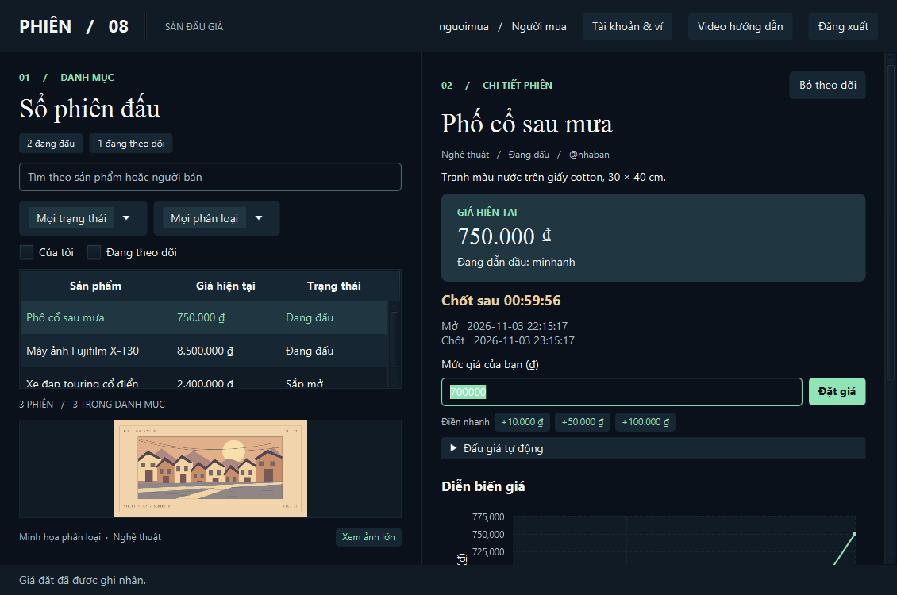

# Phiên 08 · Hệ thống đấu giá trực tuyến

Ứng dụng desktop tiếng Việt của Nhóm 8, dùng Java 25, JavaFX/FXML, Maven và SQLite. Nhiều client có thể cùng xem một sản phẩm, trả giá và theo dõi người dẫn đầu trên biểu đồ thời gian thực.

## Chạy bản demo



[Xem hướng dẫn phòng đấu và nạp ví](src/Client/view/resources/guide/phien-08.mp4). Nút **Video hướng dẫn** trong ứng dụng mở cùng tệp bằng trình phát MP4 của máy.

Cần JDK 25 và Maven trên PATH. Kiểm tra bằng `mvn -version`. Lần build đầu cần truy cập Maven Central hoặc có sẵn các phụ thuộc trong cache Maven.

**PowerShell 1 · Máy chủ**

```powershell
cd D:\Group8\HeThongDauGia-group-8
mvn compile exec:java "-Dexec.args=--demo"
```

Đợi dòng `PHIÊN 08 | 127.0.0.1:5050` xuất hiện. Giữ cửa sổ này mở.

**PowerShell 2 · Client**

```powershell
cd D:\Group8\HeThongDauGia-group-8
mvn javafx:run
```

Mở thêm một cửa sổ PowerShell và chạy lại lệnh client để thử hai tài khoản đồng thời.

| Tài khoản demo | Vai trò | Mật khẩu mặc định |
| --- | --- | --- |
| `nguoimua` | Đặt giá, cấu hình giá trần và bước tự động | `Phien08demo` |
| `nhaban` | Đăng, sửa, xóa sản phẩm | `Phien08demo` |
| `admin` | Đóng sớm hoặc hủy phiên | `Phien08demo` |

Lần khởi động đầu, chế độ demo tạo ba phiên thuộc các nhóm điện tử, nghệ thuật và phương tiện. Thời hạn của các phiên được giữ nguyên khi khởi động lại. Nếu phiên mẫu đã hết hạn, đăng nhập bằng `nhaban` để mở phiên mới. File dữ liệu demo là `data/demo.sqlite`.

## Trình diễn từ đầu đến cuối

1. Đăng nhập bằng `nhaban`. Chọn **Đăng sản phẩm**, nhập giá khởi điểm 100.000 đồng, đặt thời gian bắt đầu hiện tại và giờ kết thúc sau vài phút.
2. Ở client thứ hai, đăng nhập bằng `nguoimua`. Mở **Tài khoản & ví**, nạp 200000 đồng mô phỏng, rồi chọn sản phẩm và đặt 110000. Client người bán sẽ thấy giá và lịch sử mới.
3. Mở **Đấu giá tự động**, nhập trần 150000, bước 5000 và lưu quy tắc. Dùng cửa sổ thứ ba để đăng ký người mua khác, nạp 200000 đồng và đặt 120000. Server sẽ trả 125000 thay người mua đầu tiên. Cả hai cửa sổ nhận được kết quả.
4. Để thử gia hạn, đặt một giá hợp lệ trong 10 giây cuối. Giờ chốt sẽ tăng thêm 60 giây. Nhiều lượt tự động phát sinh từ cùng một yêu cầu chỉ gia hạn một lần.
5. Chờ hết giờ hoặc dùng `admin` để đóng sớm. Người thắng bấm **Thanh toán từ ví** và xác nhận số tiền. Server trừ ví người thắng, cộng ví người bán và chuyển phiên sang **Đã thanh toán** cùng lúc.
6. Dùng **Xuất JSON** dưới biểu đồ để lưu thông tin phiên cùng lịch sử công khai.

## Máy chủ với dữ liệu riêng

### Tài khoản và ví mô phỏng

Vào **Tài khoản & ví** để nạp, rút VND mô phỏng, xem số dư, tiền đang giữ, số tiền khả dụng và 100 giao dịch gần nhất. Tài khoản mới có số dư 0. Nạp và rút chỉ ghi sổ trong SQLite của bài tập.

Khi đặt giá hoặc đăng ký auto-bid, ví cần đủ tiền cho phiên đó sau khi trừ tiền đã cam kết ở các phiên khác. Mỗi phiên giữ mức lớn hơn giữa giá đang dẫn đầu và trần tự động còn hiệu lực của chính người mua. Khi hủy phiên, bỏ quy tắc, bị vượt giá hoặc kết thúc phiên, hệ thống tính lại khoản giữ. Phiên đã chốt chỉ giữ giá thắng cho tới lúc thanh toán.

Trong **Hồ sơ**, người dùng có thể đổi tên hiển thị và đổi mật khẩu bằng mật khẩu hiện tại. Đổi mật khẩu đăng xuất các kết nối khác của cùng tài khoản. Admin có thêm tab **Quản lý tài khoản** để xem danh sách, khóa hoặc mở khóa người mua và người bán. Hệ thống từ chối khóa quản trị viên hoặc người dùng còn khoản tiền đang giữ.

Khi nâng cấp cơ sở dữ liệu cũ, hệ thống ghi một lần số dư chuyển đổi bằng cam kết còn giữ của từng người mua theo trạng thái đã lưu. Các khoản này mang nhãn **Số dư chuyển đổi** trong lịch sử ví. Phiên đã thanh toán trước bản nâng cấp giữ nguyên kết quả.

### Ảnh và theo dõi phiên

- Người bán chọn ảnh JPEG/PNG tối đa 16 MB trong hộp **Đăng sản phẩm** hoặc **Sửa sản phẩm**. Client thu nhỏ cạnh dài xuống 1.000 px trước khi gửi. Ảnh được lưu cùng phiên trong SQLite và có thể xem từ máy khác.
- Phòng đấu hiện ảnh người bán hoặc tranh minh họa của phân loại. Chọn **Xem ảnh lớn** để xem rõ chi tiết. Khi sửa thông tin, giữ nguyên ô ảnh để giữ ảnh cũ hoặc bấm **Bỏ ảnh** để dùng lại tranh minh họa.
- **Theo dõi phiên** lưu vào tài khoản. Chọn **Đang theo dõi** để lọc các phiên đã lưu. Bộ lọc phân loại, trạng thái, ô tìm kiếm và bộ lọc **Của tôi** có thể dùng đồng thời.
- Các nút **+10.000 ₫**, **+50.000 ₫** và **+100.000 ₫** điền giá đề xuất theo mức hiện tại. Người mua kiểm tra số tiền rồi bấm **Đặt giá** để gửi.

### Cấu hình

Chạy `mvn compile exec:java` để dùng `data/auction.sqlite`. Người mua và người bán tự đăng ký ở màn hình đầu. Để tạo quản trị viên, đặt biến môi trường `AUCTION_ADMIN_PASSWORD` trước lần khởi động đầu, với mật khẩu từ 8 đến 128 ký tự. Server chỉ tạo `admin` nếu tài khoản chưa tồn tại.

Máy chủ mặc định lắng nghe trên loopback. Khi trình diễn qua mạng LAN tin cậy, truyền địa chỉ IP LAN của máy chủ bằng `"-Dauction.host=<IP-LAN>"` và cổng bằng `"-Dauction.port=5050"` vào lệnh Maven của server. Trên client, mở **Cài đặt kết nối** ở màn hình đăng nhập để nhập cùng IP và cổng. Giao thức hiện dùng TCP/JSON thuần. Dữ liệu riêng có thể đặt bằng `"-Dauction.db=<đường-dẫn-file>"`.

## Build và kiểm thử

```powershell
mvn test
mvn "-Dtest.fx=true" verify
```

Lệnh đầu chạy test nghiệp vụ và socket. Lệnh thứ hai mở JavaFX để thử đăng nhập, đặt giá, nhận giá của client khác, chụp hai màn hình vào `target` rồi đóng gói JAR. Chạy ứng dụng qua hai lệnh Maven ở trên để nạp đầy đủ phụ thuộc. GitHub Actions chạy bộ test có giao diện bằng Xvfb khi có push hoặc pull request.

## Tổ chức mã

| Thư mục | Trách nhiệm |
| --- | --- |
| `src/Client` | Client socket, controller JavaFX, FXML, định dạng tiền và thời gian, CSS |
| `src/Server` | Xác thực, điều phối socket, đấu giá, đồng hồ đóng phiên, JDBC |
| `src/Shared` | Cây kế thừa người dùng/sản phẩm, phiên, lượt đấu, ngoại lệ và giao thức |
| `src/Test/test` | Test JUnit cho thời gian, phân quyền, cạnh tranh, lưu trữ, socket và JavaFX |
| `.github/workflows` | Build và test tự động trên Java 25 |

Xem [kiến trúc và quy tắc nghiệp vụ](docs/architecture.md), [sơ đồ lớp](docs/class-diagram.md) và [quy trình đóng góp](docs/CONTRIBUTING.md).
