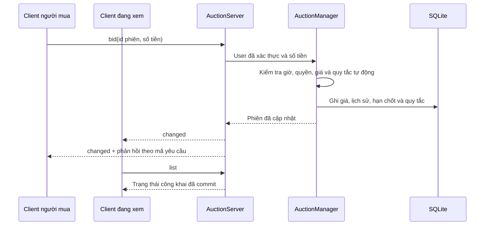

# Kiến trúc Phiên 08

## Đường đi của một lượt đặt giá

Mỗi kết nối TCP có một phiên đăng nhập và một luồng ảo đọc yêu cầu. Mã yêu cầu giúp client phân biệt phản hồi với sự kiện. Khi có thay đổi, server đánh thức luồng gửi sự kiện của từng kết nối đã đăng nhập. Hàng đợi gộp các thông báo liên tiếp để client chậm không giữ khóa nghiệp vụ. Client tải lại danh mục khi nhận thông báo. Đồng hồ đếm ngược trong JavaFX chỉ phục vụ hiển thị.

Một server giữ khóa file dành riêng cho cơ sở dữ liệu và dùng chung một `AuctionManager` cho mọi kết nối. Các lệnh kiểm tra trạng thái, xử lý giá và ghi kết quả được tuần tự hóa trong manager. Một câu lệnh SQLite ghi cả lịch sử lẫn quy tắc riêng, rồi mới thông báo. Thiết kế phục vụ mô hình một server của bài tập.

## Vòng đời phiên

- **OPEN** chờ giờ mở. Đến giờ, server chuyển sang **RUNNING**.
- **RUNNING** nhận giá nguyên đồng cao hơn giá hiện tại. Người đang dẫn đầu có thể chỉnh quy tắc tự động. Người bán chỉ sửa hoặc xóa phiên của mình khi chưa có lượt đấu.
- **FINISHED** chốt lịch sử và người thắng. Phiên không có lượt đấu kết thúc mà không có người thắng.
- **PAID** ghi nhận chuyển tiền từ ví người thắng sang ví người bán trong cùng giao dịch SQLite với trạng thái phiên. **CANCELED** do quản trị viên hủy và giải phóng tiền giữ cho phiên.

Bộ lập lịch kiểm tra các mốc đến hạn mỗi 250 ms. Server cũng kiểm tra hạn trước khi xử lý lệnh. Khi mở lại ứng dụng, các phiên quá hạn được cập nhật từ thời gian lưu trong SQLite.

## Giá tự động

Mỗi người mua có thể lưu một mức trần và một bước giá cho mỗi phiên. Khi thay quy tắc, thứ tự ưu tiên được cấp lại. PriorityQueue xếp trần cao hơn trước, cùng trần thì ưu tiên người đăng ký trước. Server tìm giá của đối thủ mạnh nhất, cộng bước của người thắng và chặn kết quả ở mức trần. Cách tính này tránh tạo hàng triệu giao dịch trung gian nếu bước giá rất nhỏ.

Ví dụ giá đang là 100 đồng, A đặt trần 200 với bước 5. A dẫn đầu ở 105. B trả 120 bằng tay thì lịch sử ghi hai lượt 120 của B và 125 tự động của A. Nếu B đăng ký cùng trần 200, A vẫn thắng ở 200 nhờ đăng ký trước. Client chỉ được xem quy tắc của chính tài khoản đó. Tắt tự động giữ nguyên các lượt đã cam kết.

## Giao diện

Danh mục dùng TableView có sắp xếp, tìm kiếm và bộ lọc. Bảng và khung chi tiết dùng chung một dòng được chọn. Giá, người dẫn đầu, thời gian chốt và lịch sử cùng đọc từ một bản chụp của server. Kiểu chữ serif cho tiêu đề, chữ hệ thống cho dữ liệu và màu bạc hà cho hành động chính. Trạng thái phiên luôn có nhãn văn bản. Bộ token màu gốc, ngữ nghĩa và thành phần nằm ở `src/Client/view/resources/css/auction.css`.

## Đối chiếu các nhóm bài tập

| Bài | Vị trí để xem hoặc chạy thử |
| --- | --- |
| 01–04 | Maven Java 25, hai điểm khởi động, JUnit và hướng dẫn đóng góp |
| 05–08 | Cây User, UserService, kiểm tra vai trò trên server |
| 09–12 | ItemFactory, cây Item, publish/delete và hộp thoại sản phẩm |
| 13–16 | Auction, BidTransaction, bid, finish, settle |
| 17–20 | Status, AuctionException, khóa trong manager, observer qua socket |
| 21–24 | Xuất file JSON, AuctionStore JDBC, lệnh echo và giao thức nhiều client |
| 25–28 | Login.fxml, Room.fxml, biểu mẫu người bán và bảng danh mục |
| 29–32 | AuctionClient, quản trị phiên, NetworkTest, ViewTest, GitHub Actions và tài liệu |
| 33–35 | PriorityQueue, gia hạn 10/60 giây và LineChart theo timestamp |
