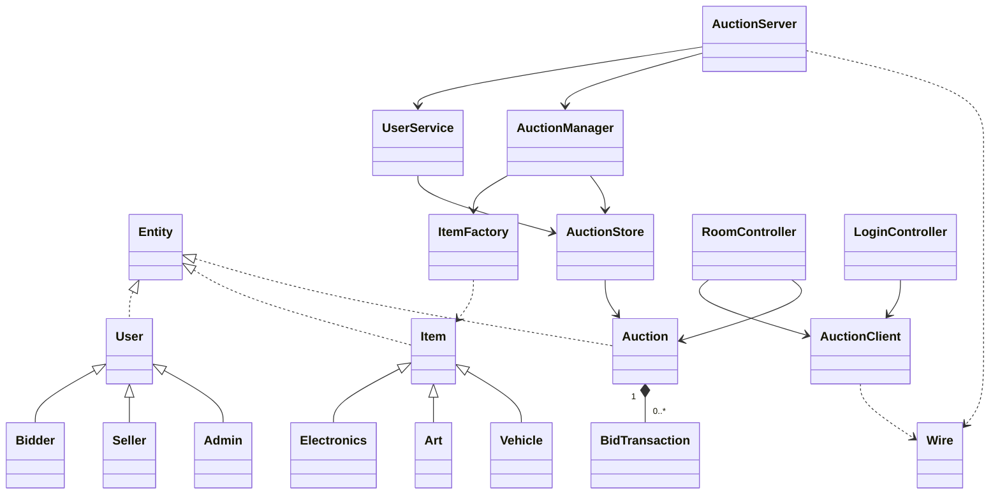

# Sơ đồ lớp

`Entity` cung cấp định danh. `User.role()` và `Item.category()` sử dụng đa hình. `ItemFactory` chọn lớp sản phẩm từ danh mục. `Auction` là bản chụp bất biến gửi đến client. BIDDER, SELLER và ADMIN được khôi phục từ tài khoản do server xác thực. Giá trần tự động chỉ tồn tại trong dữ liệu riêng của server và phản hồi cho chính chủ sở hữu.
